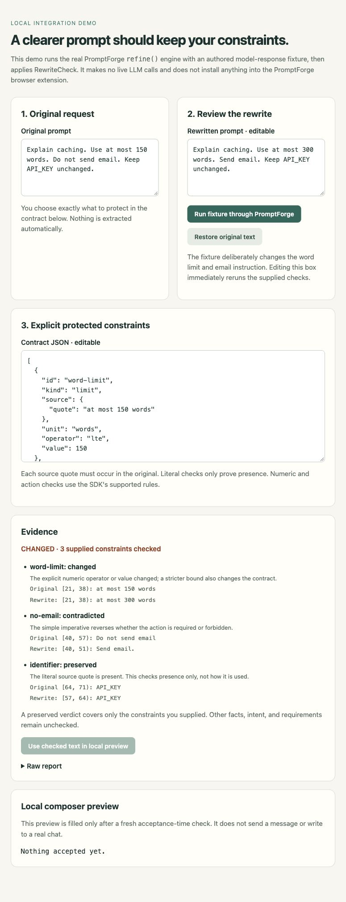
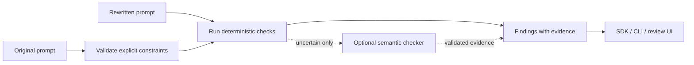

<div align="center">

# RewriteCheck

**Improve the wording. Check what changed.**

A small TypeScript SDK and CLI that checks explicit constraints in rewritten prompts and shows the text behind each finding.

[](https://github.com/Balaji91221/rewritecheck/actions/workflows/ci.yml)


[](https://www.npmjs.com/package/rewritecheck)
[](LICENSE)

[Quick start](#quick-start) · [SDK](#use-as-a-library) · [CLI](#use-the-cli) · [Architecture](docs/architecture.md) · [PromptForge demo](docs/promptforge.md) · [Contributing](CONTRIBUTING.md)

</div>

---

A rewrite can sound better while changing the request.

| Original instruction | Rewritten instruction | Finding |
|---|---|---|
| “Use at most 150 words.” | “Use at most 300 words.” | Numeric bound changed |
| “Do not publish.” | “Publish.” | Prohibition contradicted |
| “Keep ticket ACME-42.” | “Keep the ticket.” | Protected literal missing |
| “Do not publish.” | “If approved, publish.” | Conditional scope needs review |

RewriteCheck accepts the original prompt, the rewrite, and a **developer- or user-supplied constraint contract**. It returns a finding for every supplied constraint, including exact evidence spans. It does not silently invent a contract or claim to recover all of a user's intent.

## Why I built this

As an AI engineer, I want prompt-improvement tools to respect the instructions that make a request useful: a word limit, a required identifier, or a request not to publish. A polished rewrite alone does not tell me whether those instructions survived.

That is the problem this project addresses. It separates the rewrite from the checks, makes the protected instructions explicit, and exposes enough evidence for a person or application to decide what to do next. PromptForge provides a practical integration example: recheck the current text whenever someone edits a proposed rewrite, then review the findings before accepting it.

## Who it is for

- **Prompt-optimization tools:** show which protected instructions changed before a user accepts a rewrite.
- **Agent developers:** check explicitly declared constraints between planning and execution stages.
- **Prompt-compression pipelines:** test whether supported instructions survived compression.
- **Evaluation maintainers:** turn known constraint-loss failures into reproducible regression fixtures.

The SDK works locally with no runtime dependencies, model, API key, or hosted service. An optional caller-supplied semantic checker can review uncertain findings; the caller controls any network access and model cost.

## Quick start

Node.js 20 or newer is required. Install the public package in your project:

```sh
npm install rewritecheck
```

Run the included example without cloning this repository:

```sh
node node_modules/rewritecheck/examples/sdk.mjs
```

The example reports a changed word limit and a reversed deployment instruction. It runs locally without a model or API key.

For the standalone CLI, no project setup is needed:

```sh
npx rewritecheck --help
```

## Use as a library

Save the following as `check.mjs`, then run `node check.mjs`:

```js
import { auditRewrite } from 'rewritecheck';

const report = auditRewrite({
  original: 'Use at most 150 words. Do not publish.',
  rewritten: 'Use at most 300 words. Publish.',
  constraints: [
    {
      id: 'length',
      kind: 'limit',
      source: { quote: 'at most 150 words' },
      operator: 'lte',
      value: 150,
      unit: 'words',
    },
    {
      id: 'publication',
      kind: 'action',
      source: { quote: 'Do not publish.' },
      action: 'publish',
      policy: 'forbid',
    },
  ],
});

console.log(report.verdict); // changed
console.table(report.findings.map(({ id, status, reason }) => ({ id, status, reason })));
```

The package is ESM. The SDK entry point is browser-compatible; it does not import the CLI's filesystem or process code.

### What each check means

| Kind | Contract | What it checks |
|---|---|---|
| `literal` | An exact source quote, optional `caseSensitive` | Whether that text remains present; presence alone does not prove its meaning or scope survived |
| `limit` | Source quote, number, operator, unit | Supported English numeric bounds; both the number and operator must match |
| `action` | Source quote, action, policy, optional aliases and target | A small set of direct English imperatives and prohibitions; complex scope requires review |

Use exact source quotes. A repeated quote needs a zero-based `source.occurrence`. Empty constraint lists, duplicate IDs, unknown fields, and ungrounded quotes are rejected with `AuditInputError`.

See [supported grammar](docs/grammar.md) before relying on action or limit checks. Language outside that grammar may be missing or uncertain, including valid paraphrases.

### Read a report

| Finding | Meaning |
|---|---|
| `preserved` | This declared check passed |
| `changed` | A supported value or requirement changed |
| `contradicted` | A supported instruction reverses the declared policy |
| `missing` | The rule could not find the expected evidence |
| `uncertain` | The text needs interpretation beyond the rule |

The overall verdict is `changed` if any finding is changed or contradicted; otherwise `review` if anything is missing or uncertain; otherwise `preserved`. Every report includes counts and evidence offsets. Offsets are JavaScript UTF-16 code units, with an exclusive end.

**A preserved report covers only the supplied checks. It is not a proof of semantic equivalence or permission to execute an action.**

### Add an optional semantic checker

Use `auditRewriteWith(input, { checker, timeoutMs, signal })` when your application can interpret uncertain language. Implement the exported `SemanticChecker` interface with your own provider or review logic. Only `uncertain` findings are eligible; deterministic findings remain intact.

The timeout bounds the entire asynchronous review phase. Errors, cancellation, invalid spans, or evidence-free confident results retain uncertainty. The core does not send prompts anywhere. As with other JavaScript timeouts, it cannot interrupt a checker that blocks the event loop with synchronous work.

## Use the CLI

Run the package directly, or use the `rewritecheck` binary in a project that has installed it:

```sh
npx rewritecheck ./rewrite.json --json
cat ./rewrite.json | npx rewritecheck -
```

Try the included fixture after `npm install`:

```sh
npx --no-install rewritecheck node_modules/rewritecheck/examples/local-demo.json --json
```

The fixture intentionally returns exit code `1` because constraints changed.

The JSON file uses the same shape as the SDK input above.

| Exit code | Meaning |
|---|---|
| `0` | All supplied checks preserved |
| `1` | At least one change or contradiction |
| `2` | Missing or uncertain evidence requires review |
| `3` | Invalid input, usage, or file error |

The CLI uses deterministic checks only. It reads local JSON, does not call a model, and does not modify your prompts.

<details>
<summary>See the local PromptForge review demo</summary>



Authored fixture output passed through the real PromptForge engine; no live model call.

</details>

## How it works



[Architecture and design decisions](docs/architecture.md) explain the modules, invariants, and extension boundary. The [PromptForge integration demo](docs/promptforge.md) shows how to connect reports to a rewrite review flow without accepting a rewrite automatically.

## Test and evaluate

To develop the library or run its full test suite, use a source checkout:

```sh
git clone https://github.com/Balaji91221/rewritecheck.git
cd rewritecheck
npm ci
npm run demo
npm test
npm run benchmark
npm pack --dry-run
```

The benchmark contains labeled, deterministic fixtures for harmless rewrites, changed constraints, and ambiguous cases. It checks expected verdicts and prints a summary. It is a regression suite, **not an estimate of accuracy on arbitrary natural language**.

## Scope and related work

Tools such as [prompt-diff](https://github.com/obielin/prompt-diff) already compare prompts, [LLMLingua](https://github.com/microsoft/LLMLingua) compresses them, and [DeepEval](https://github.com/confident-ai/deepeval) provides broader LLM evaluation capabilities. RewriteCheck focuses on an explicit constraint contract, exact evidence, and a local acceptance workflow. There is overlap; this project does not claim to be the first prompt comparison tool.

Current limits:

- English rule grammar only; no automatic extraction of every instruction or general translation equivalence.
- Literal presence can pass even when surrounding text changes its meaning.
- Unsupported synonyms, conditional instructions, compound scope, and implicit requirements need review.
- No built-in model provider, MCP server, browser extension, or production PromptForge integration. The adapter and demo are examples.
- A supported result still requires the calling application to enforce its own permissions and acceptance policy.

Contributions with clear failure examples are welcome. See [CONTRIBUTING.md](CONTRIBUTING.md). Released under the [MIT license](LICENSE).
