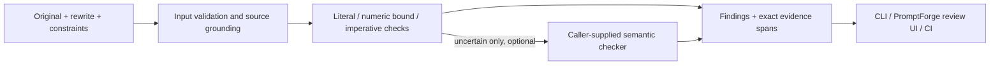

# Architecture

RewriteCheck checks an explicit constraint contract against a rewritten prompt. It does not infer complete user intent or authorize agent actions.

## Responsibilities

- `types.ts`: public discriminated unions and report schema.
- `validation.ts`: validate untrusted inputs and resolve each quote to a source span.
- `rules.ts`: bounded deterministic checks. No IO, provider clients, or global state.
- `audit.ts`: orchestrate checks, aggregate results, and optionally review uncertain results.
- `cli.ts`: local JSON input, readable/JSON reports, and exit status.
- A PromptForge adapter maps the report into a review state. It must not automatically accept a rewrite.

## Invariants

Every constraint has a unique ID and an exact source quote. Repeated quotes require an explicit zero-based occurrence. Evidence offsets must slice back to the evidence text. Empty constraint lists are rejected rather than reporting a vacuous pass. Numeric bounds are equal only when both the operator and value match; stricter bounds still change the requested contract. Deterministic evidence is bounded to 64 spans per finding; action or numeric candidate overflow requires review. Rules intentionally cover a small documented English grammar. Unsupported context is uncertain, and missing evidence requires review.

A report is `changed` if a finding is changed or contradicted, `review` if any finding is missing or uncertain, and `preserved` only when every supplied constraint passes its declared check. Literal preservation proves presence only, not semantic equivalence. Optional semantic checks refine uncertain findings, are timeout-bounded, and must return valid source spans. Provider failures remain uncertain. Neither verdict nor score grants permission to execute a tool.

## Design choices

Use functions and discriminated unions for three concrete checks. No inheritance or plugin registry is needed yet. The CLI depends on the public SDK, and the SDK has no dependency on Node-only filesystem modules. Semantic interpretation is behind one small caller-provided interface. Each implementation must obey evidence and uncertainty guarantees; contract tests cover these rather than relying on type compatibility alone.

No database or hosted service is needed for v0.1. Calls are stateless. CLI inputs and reports remain local; callers control whether an optional semantic checker sends text to a provider.
